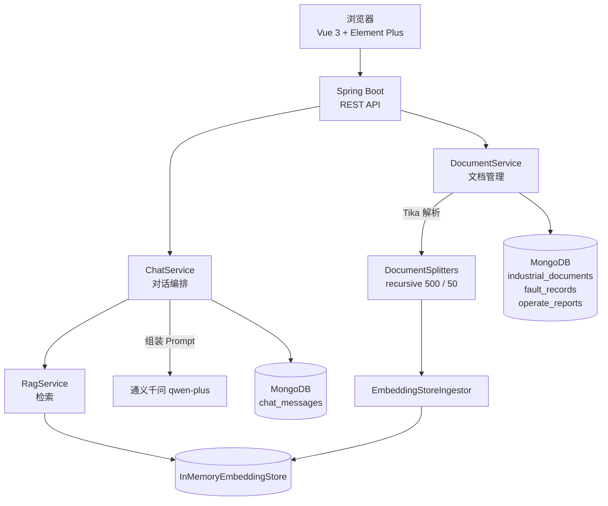

# 工业设备智能运维 AI 平台

基于 **LangChain4j + 通义千问** 的工业设备运维知识库问答系统。把设备手册、故障记录、操作报告沉淀成可检索的私有知识库，用自然语言提问，答案只依据文档内容生成，无据可依时明确拒答。

> 校内实训项目 · 2026.05 – 2026.06
> 商丘师范学院 软件工程

<!--
  📷 建议在这里放一张对话界面截图：把图片存成 docs/screenshot-chat.png，
     然后删掉下面两行的注释符号，README 立刻好看很多。
-->
<!--  -->

---

## 项目简介

工厂里设备手册、历史故障记录、标准操作报告分散且专业性强，新人查资料慢，老师傅的经验落不到纸面。现场人员问「离心泵轴承温度上限是多少」「气蚀怎么判断」，往往要翻半天手册。

本项目把这些文档做成可对话的知识库：

- 文档上传后自动解析、切分、向量化入索引
- 提问时先检索最相关的文档片段，再让大模型基于片段作答
- 系统提示中强制约束「仅依据参考资料作答、无据可依时拒答」，降低工业参数被编造的风险
- 对话记录按会话存 MongoDB，支持连续追问

---

## 功能

### 知识库管理
- 上传 PDF / Word / TXT 等格式文档（Apache Tika 解析）
- 按设备类型（离心泵、空压机、风机、换热器、阀门、电机……）归类
- 文档列表、按类型查询、删除
- 上传后增量摄取进索引

### 智能问答
- 基于向量的 RAG 检索增强问答
- 多轮对话（按 `sessionId` 保留最近 20 条上下文）
- 拒答机制：文档中没有的内容不作答
- 会话历史查询

### 业务模块
- 故障记录管理
- 操作报告管理

---

## 技术栈

| 分类 | 技术 | 版本 |
|---|---|---|
| 语言 / 运行时 | Java | 17 |
| 应用框架 | Spring Boot | 3.2.6 |
| AI 框架 | **LangChain4j** | 1.1.0-beta7 |
| 大模型 | 通义千问 `qwen-plus`（DashScope） | — |
| Embedding | `text-embedding-v4` | — |
| 向量存储 | `InMemoryEmbeddingStore` | — |
| 数据库 | MongoDB（Spring Data MongoDB） | — |
| 文档解析 | Apache Tika | 随 LangChain4j |
| 前端 | Vue 3 + Vite + Element Plus | 构建产物内置于 `static/` |

---

## 系统架构



---

## RAG 链路（核心设计）

### 写入侧

```
上传文档
  → Apache Tika 解析出纯文本
  → DocumentSplitters.recursive(500, 50) 递归切分
      500 token 一块，相邻重叠 50 token，尽量在段落/句子边界断开
  → EmbeddingStoreIngestor 批量 embedding
  → 写入 InMemoryEmbeddingStore
```

索引在 `@PostConstruct` 中启动时全量构建一次；之后每上传一份文档只做**增量摄取**，不重建全库。

### 读取侧

```
用户提问
  → EmbeddingStoreContentRetriever 检索
      maxResults = 5      召回最相关的 5 个片段
      minScore   = 0.3    低于阈值直接丢弃，宁可少给也不给噪音
  → 拼进 Prompt 的 context
  → 通义千问生成回答
  → 落库 MongoDB
```

### Prompt 约束

系统提示中明确要求：

> 你是资深工业运维专家……回答严格仅参考提供的工业设备文档，禁止编造不存在的设备参数/故障方案。文档无相关内容统一回复：「抱歉，这个问题我暂时无法回答，请联系技术支持。」

工业场景里编造一个参数比不回答危险得多，所以这里用的是**固定话术**而不是让模型自由表达「我不知道」——否则每次说法都不一样，前端也没法识别。

---

## 版本演进（为什么要做向量检索）

代码里保留了 `ragChat1()` 和 `ragChat()` 两个方法，对应两版实现：

| 版本 | 做法 | 问题 |
|---|---|---|
| v1 · `ragChat1` | 把该设备类型下**所有文档全量拼进 Prompt** | 文档一多就超 token；模型在一堆无关资料里容易发散 |
| v2 · `ragChat` | 向量检索只注入 top5 片段 | Prompt 长度大幅下降，回答更聚焦 |

从 v1 到 v2 的改造，是这个项目里最有价值的一次迭代。

---

## 快速开始

### 环境要求

- JDK 17+
- Maven 3.8+
- MongoDB 6+
- 通义千问 API Key（[DashScope 控制台](https://dashscope.console.aliyun.com/)）

### 1. 启动 MongoDB

```bash
docker run -d --name mongo -p 27017:27017 mongo:6
```

或用本地安装的 MongoDB，数据库名会自动创建为 `industrial_ai_db`。

### 2. 配置 API Key

`application.yml` 里用的是环境变量，不要把密钥写进配置文件：

```powershell
# Windows PowerShell
$env:DASHSCOPE_API_KEY="sk-xxxxxxxxxxxxxxxx"
```

```bash
# Linux / macOS
export DASHSCOPE_API_KEY="sk-xxxxxxxxxxxxxxxx"
```

### 3. 启动

```bash
mvn spring-boot:run
```

服务地址：http://localhost:8080
前端页面：http://localhost:8080/index.html

### 4. 灌入文档

```bash
curl -X POST http://localhost:8080/api/document/upload \
  -F "file=@离心泵运行与维护规程.txt" \
  -F "deviceType=离心泵"
```

### 5. 提问

```bash
curl -X POST http://localhost:8080/api/chat/rag \
  -H "Content-Type: application/json" \
  -d '{"sessionId":"demo-1","userMessage":"离心泵滚动轴承的温度上限是多少？","deviceType":"离心泵"}'
```

---

## 接口一览

| 方法 | 路径 | 说明 |
|---|---|---|
| POST | `/api/chat` | 普通对话（带会话记忆，无检索） |
| POST | `/api/chat/rag` | **RAG 问答**，JSON body：`sessionId` / `userMessage` / `deviceType` |
| POST | `/api/chat/t` | 单轮对话，无记忆 |
| GET | `/api/chat/history/{sessionId}` | 会话历史 |
| POST | `/api/document/upload` | 上传文档（multipart：`file` + `deviceType`） |
| GET | `/api/document/all` | 全部文档 |
| GET | `/api/document/device/{deviceType}` | 按设备类型查文档 |
| DELETE | `/api/document/documents/{id}` | 删除文档 |

---

## 项目结构

```
industrial-ai-platform/
├── src/main/java/com/example/industrialai/
│   ├── IndustrialAiPlatformApplication.java
│   ├── config/
│   │   ├── CorsConfig.java              # 跨域
│   │   └── Langchain4JConfig.java       # QwenChatModel Bean
│   ├── controller/
│   │   ├── ChatController.java          # /api/chat
│   │   ├── DocumentController.java      # /api/document
│   │   ├── FaultRecordController.java
│   │   └── OperateController.java
│   ├── entity/
│   │   ├── ChatMessage.java
│   │   ├── IndustrialDocument.java
│   │   ├── FaultRecord.java
│   │   └── OperateReport.java
│   ├── repository/                      # Spring Data MongoDB
│   └── service/
│       ├── ChatService.java             # 对话编排（v1 / v2 两版）
│       ├── RagService.java              # 切分、索引、检索
│       ├── DocumentService.java         # Tika 解析与入库
│       ├── FaultRecordService.java
│       └── OperateService.java
├── src/main/resources/
│   ├── application.yml
│   └── static/                          # 前端构建产物
├── frontend/                            # 前端源码（Vue 3 + Vite）
└── pom.xml
```

---

## 已知限制

写在 README 里而不是藏着，因为这些都是下一步要改的：

| 限制 | 影响 | 改进方向 |
|---|---|---|
| 向量库是 `InMemoryEmbeddingStore` | 服务重启索引丢失，需重新 embedding 全量文档；无法多实例共享 | 换 PgVectorStore 或 Milvus 持久化 |
| 只有纯向量检索 | 对「气蚀」「NPSHr」「BPFO」这类专有名词召回不稳定 | 引入 BM25 关键词检索 + RRF 融合 |
| 没有 Rerank 重排 | 召回的 5 条片段排序不够准 | 接入 BGE-Reranker / gte-rerank |
| 切分参数凭经验定（500/50） | 未验证是否最优，可能切断语义边界 | 用评测集扫 300/500/800 三档 |
| `deviceType` 未作用于检索 | 参数只写进 Prompt，没有做 metadata 过滤，跨设备检索会引入噪音 | 给向量库加 metadata filter |
| 没有鉴权 | 任何人都能上传/删除文档 | 加 JWT + 知识库归属隔离 |
| 没有效果评测 | 无法量化优化收益 | 自建评测集，统计 Recall@5 与答案准确率 |

---

## Roadmap

- [ ] 建立 40 条评测集，跑出基线准确率
- [ ] 接入 Rerank 重排
- [ ] 引入 BM25 + 向量 RRF 混合检索
- [ ] 向量库迁移到 PostgreSQL + pgvector
- [ ] `deviceType` 作为 metadata 参与检索过滤
- [ ] 补 Docker Compose 一键启动
- [ ] 补单元测试

---

## 说明

本项目为**校内实训项目**，选题与整体方向由指导老师确定。我负责后端实现与 AI 链路搭建：
RAG 链路设计、文档切分与索引、对话编排、Prompt 约束设计，以及从「全量拼 Prompt」到
「向量检索 + 拒答约束」的版本改造。前端界面借助 AI 编程工具生成，我负责联调与调整。

---

## License

仅用于学习与技术交流。

---

## 前端源码

`frontend/` 是前端源码（Vue 3 + Vite + Element Plus）。

`src/main/resources/static/` 里是**已构建的产物**——克隆后直接 `mvn spring-boot:run`
就能看到完整页面，不需要装 Node。

只有要改界面时才需要动前端：

```bash
cd frontend
npm install
npm run dev      # 开发服务器，默认 5173
npm run build    # 构建，把 dist/ 的内容覆盖到 ../src/main/resources/static/
```

> 开发模式下前端跑在 5173、后端跑在 8080，跨域已经在 `CorsConfig` 里放开。
